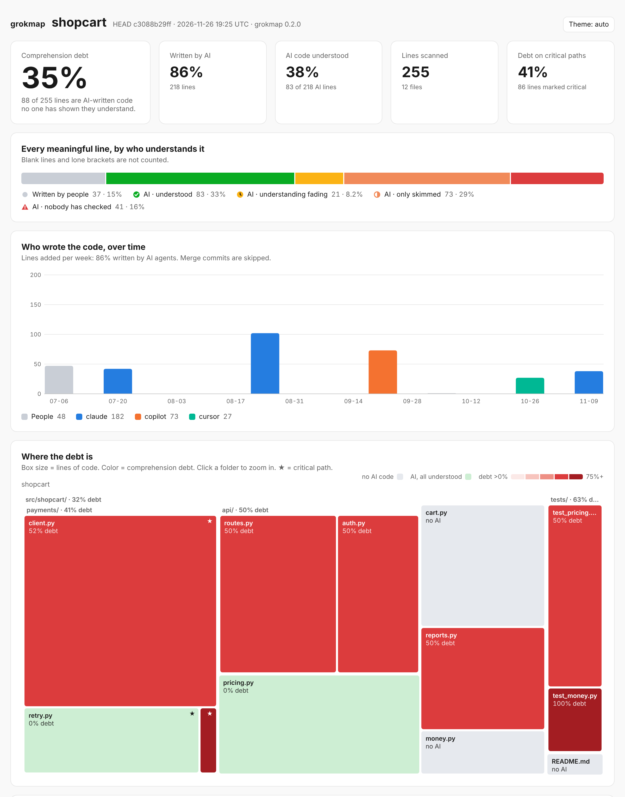

<div align="center">

# Grokmap

**Find the AI-written code nobody on your team understands, and pay it down one short quiz at a time.**

[](https://github.com/Aadithya-kl/grokmap/actions/workflows/ci.yml)
[](https://pypi.org/project/grokmap/)
[](https://registry.modelcontextprotocol.io/v0/servers?search=io.github.Aadithya-kl/grokmap)
[](https://glama.ai/mcp/servers/Aadithya-kl/grokmap)
[](https://scorecard.dev/viewer/?uri=github.com/Aadithya-kl/grokmap)


**[▶ Live demo](https://aadithya-kl.github.io/grokmap/demo/)** · [Website](https://aadithya-kl.github.io/grokmap/) · [Study: how much of open source is AI-written?](https://aadithya-kl.github.io/grokmap/study/) · [Install](#install) · [Agent skill](#add-the-skill-to-your-coding-agent) · [MCP server](#mcp-server) · [CI and PR comments](#in-ci)

<picture>
  <source media="(prefers-color-scheme: dark)" srcset="docs/report-dark.png">
  
</picture>

</div>

---

Coding agents now write a large share of the code we ship. The tests pass, the diff looks clean, it gets merged. A month later something breaks at 2am, and nobody on the team can explain how that module works.

That gap has a name: **comprehension debt**, the difference between how much code is in your system and how much of it any person actually understands. It doesn't show up in linters, coverage or code review dashboards.

**grokmap measures it.** It traces every line in your repo to the commit that wrote it, recognises commits made by AI agents (Claude Code, Copilot, Cursor, Codex, Aider, Devin, Gemini…), and checks them against a shared ledger of who has *shown* they understand that code. Then it draws you a map.

```
$ grokmap status
grokmap · shopcart @ c3088b29ff

  Comprehension debt   34.5%
  Lines scanned        255 in 12 files
  Written by AI        218 lines (85.5%)  — claude 141, copilot 56, cursor 21
    understood         83  (38%)
    fading             21
    skimmed            73
    nobody checked     41
  Critical paths       40.7% debt over 86 lines
  Understood by        alex@example.com (53), priya@example.com (51)

Riskiest files                                         lines      AI  unread    debt
src/shopcart/payments/client.py                           64      64      33     52%
src/shopcart/api/routes.py                                33      33       0     50%
src/shopcart/api/auth.py                                  23      23       0     50%

Pay it down: ask your coding agent to run `grokmap quiz <file>` and quiz you.
```

## How much of your code is AI-written?

`grokmap status` answers that in seconds, and `grokmap trend` shows how it changed month by month. We ran it on 18 well-known open-source projects. In the [MCP reference servers](https://github.com/modelcontextprotocol/servers), 94% of commits from August to October 2026 were co-authored by Claude; in VS Code, 74% were co-authored by Copilot. Read the [full study](https://aadithya-kl.github.io/grokmap/study/), including its limitations.

New to the idea? [What is comprehension debt, and how do you measure it?](https://aadithya-kl.github.io/grokmap/comprehension-debt/)

## How you pay it down: your agent quizzes you

grokmap ships an **agent skill**. After your coding agent writes something substantial, it offers a two-minute quiz on exactly the lines you haven't shown you understand, grades you honestly, and records the result:

```text
you    > yes, quiz me before I commit
agent  > (runs: grokmap quiz --uncommitted)
         Q1 of 3. A charge request times out after the provider already took the money.
         What stops the retry from charging the customer twice?
you    > the idempotency key — it's a hash of order id and amount, so the retry reuses it
agent  > Correct (1/1). The provider sees the same Idempotency-Key and returns the first charge.
         Q2 of 3. A card is declined with HTTP 402. How many times do we call the API, and why?
you    > three times? because of the retry decorator
agent  > Not quite (0/1). 4xx errors are raised with retryable=False, and the decorator re-raises
         those immediately, so it's one call. Only 5xx and network errors are retried.
         ...
agent  > Score 0.67. Recorded (grokmap mark … --score 0.67 --method quiz).
         Worth rereading the error handling in charge() — that's where the retry rules live.
```

Understanding is tracked **per line**. If the agent later rewrites a line you were quizzed on, that line counts as new, not-yet-understood code again. Understanding older than 180 days shows as *fading*.

## Install

```bash
pipx install grokmap        # or: pip install grokmap
```

Or try it without installing: `uvx grokmap status`

Python 3.11+ and git. No other dependencies, no network calls, nothing leaves your machine.

### Add the skill to your coding agent

**Claude Code:**

```text
/plugin install grokmap --marketplace Aadithya-kl/grokmap
```

(or `/plugin marketplace add Aadithya-kl/grokmap`, then `/plugin install grokmap@grokmap`)

**Any agent that reads `SKILL.md` files** (Codex, Cursor, Gemini CLI, OpenCode…):

```bash
npx skills add Aadithya-kl/grokmap
```

or copy [`skills/grokmap/`](skills/grokmap/SKILL.md) into your agent's skills folder.

Then just say **"quiz me on the payments module"**, or let the agent offer after it finishes a change.

<a id="mcp-server"></a>
### MCP server: let your agent check before it edits

The skill teaches the agent to quiz you. The MCP server goes further: before the agent changes code, it can ask **"does anyone on this team actually understand this?"** and be more careful when the answer is no.

```json
{
  "mcpServers": {
    "grokmap": { "command": "uvx", "args": ["grokmap-mcp"] }
  }
}
```

[](https://insiders.vscode.dev/redirect/mcp/install?name=grokmap&config=%7B%22command%22%3A%22uvx%22%2C%22args%22%3A%5B%22grokmap-mcp%22%5D%7D)
[](https://cursor.com/en/install-mcp?name=grokmap&config=eyJjb21tYW5kIjogInV2eCIsICJhcmdzIjogWyJncm9rbWFwLW1jcCJdfQ==)

That block works in Claude Desktop, Cursor (`.cursor/mcp.json`), Windsurf and most other clients. Elsewhere:

```bash
claude mcp add grokmap -- uvx grokmap-mcp                  # Claude Code (the plugin above already includes it)
codex mcp add grokmap -- uvx grokmap-mcp                   # Codex CLI
code --add-mcp '{"name":"grokmap","command":"uvx","args":["grokmap-mcp"]}'   # VS Code
```

Already installed grokmap? `pip install "grokmap[mcp]"` and use `grokmap mcp` as the command instead.

Prefer Docker? `docker build -t grokmap-mcp .` in this repo, then use `docker run -i --rm -v "$PWD:/repo" grokmap-mcp` as the command.

| Tool | What the agent gets |
|---|---|
| `comprehension_risk` | For the files it's about to change: a risk level from *none* to *very high*, who understands them, and how to act (explain the change, keep the diff small, offer a quiz). |
| `repo_status` | Debt, AI share and the riskiest files. |
| `who_understands` | Who has shown they understand a file or folder, so it knows whom to ask. |
| `quiz_brief` | The exact lines you haven't shown you understand, plus grading rules. |
| `record_understanding` | Records a quiz, explanation, review or pairing result in the shared ledger. The only tool that writes. |
| `pr_comprehension` | The AI-written lines a branch adds and how many are understood. |
| `ai_trend` | How much of the code added each week or month each agent wrote. |

[](https://glama.ai/mcp/servers/Aadithya-kl/grokmap)

Plus a `quiz_me` prompt. Everything runs locally on your git history: no network calls, no API keys. It's listed in the [official MCP Registry](https://registry.modelcontextprotocol.io/v0/servers?search=io.github.Aadithya-kl/grokmap) as `io.github.Aadithya-kl/grokmap`.

## Quick start

```bash
cd your-repo
grokmap init              # .grokmap.toml + ledger + a merge rule for it
grokmap status            # the numbers
grokmap report --open     # the interactive heatmap
```

Commit `.grokmap/ledger.jsonl` so your whole team shares one map. It's one JSON object per line with a `merge=union` git rule, so merges don't conflict.

## Commands

| Command | What it does |
|---|---|
| `grokmap status` | Debt, AI share, who understands what, riskiest files. `--json` and `--markdown` for scripts and PR comments. |
| `grokmap report [-o file] [--open]` | Self-contained HTML heatmap: a zoomable treemap, hover details, filterable file table, light and dark themes. |
| `grokmap quiz [paths] [--uncommitted \| --staged \| --diff main]` | A quiz brief for your agent: the exact lines you haven't shown you understand, plus grading rules. |
| `grokmap mark <files…> --score 0.8 [--method quiz\|explain\|review]` | Record understanding. `path:10-40` or `--lines` for line ranges, folders expand to their files. |
| `grokmap diff [--base origin/main]` | The AI-written lines a branch adds and how many are understood. `--markdown` for a PR comment, `--max-unread N` to gate merges. |
| `grokmap trend [--by week\|month]` | How much of the code added over time was written by each agent. |
| `grokmap who <path>` | Who understands the AI-written code in a file or folder. |
| `grokmap check [--max-debt 40] [--critical]` | Exits 1 above the limit. For CI. |
| `grokmap badge` | An SVG badge for your README:  |
| `grokmap init` | Adds config, ledger and `.gitattributes`. |
| `grokmap mcp` | Runs the MCP server over stdio (needs `grokmap[mcp]`). |

## In CI

```yaml
# .github/workflows/grokmap.yml
on: [pull_request]
permissions:
  contents: read
  pull-requests: write      # for the PR comment
jobs:
  grokmap:
    runs-on: ubuntu-latest
    steps:
      - uses: actions/checkout@v4
        with:
          fetch-depth: 0          # blame needs full history
      - uses: Aadithya-kl/grokmap@main
        with:
          max-debt: 40            # optional: fail above 40% debt
          max-unread: 200         # optional: fail if the PR adds >200 unchecked AI lines
```

On every pull request it posts **one comment** (and keeps it up to date) like this:

> ### grokmap: comprehension check
>
> This change adds **5 AI-written lines** (claude 5) and 1 human-written line. **4 of the AI lines (80%)** have been understood by someone on the team.
>
> | File | AI lines | Understood | Not checked |
> |---|---:|---:|---:|
> | `src/shopcart/pricing.py` | 1 | 0 | 1 |
> | `src/shopcart/loyalty.py` | 4 | 4 | 0 |
>
> Before merging, the author can ask their coding agent to run `grokmap quiz --diff origin/main` for a 2-minute quiz on the unchecked lines.

It also writes the repo summary to the job page, uploads the heatmap as an artifact, and exposes `debt` and `ai-lines` as outputs. Everything is report-only unless you set a limit.

## How it works

1. **Attribution.** For every tracked text file, `git blame -w` maps each line at `HEAD` to the commit that last changed it. Blank lines and lone brackets are ignored.
2. **AI detection.** A commit counts as AI-written only when it carries evidence the tools themselves leave behind:

   | Agent | Signals |
   |---|---|
   | Claude / Claude Code | `Co-Authored-By: Claude`, "Generated with Claude Code", `Claude-Session:`, `claude[bot]` |
   | GitHub Copilot | Copilot coding agent as author, `Co-authored-by: Copilot` |
   | Cursor | `cursoragent@cursor.com` author or co-author |
   | OpenAI Codex | `chatgpt-codex` / `codex[bot]`, Codex co-author |
   | Aider | `aider:` message prefix, `(aider)` author suffix |
   | Charm Crush | `crush@charm.land` co-author |
   | Devin, Gemini / Jules, Amazon Q, Windsurf | their bot authors or co-author trailers |
   | Your own | any regex in `[grokmap.ai_patterns]`, or specific commits in `[grokmap.ai_commits]` |

   Squash merges keep co-author trailers, so detection survives the usual GitHub workflow.
3. **Understanding.** Each ledger record stores short hashes of the lines a person was quizzed on. A line is *understood* when someone passed a quiz on its current content, *skimmed* for a low score or a `review`, *fading* when the pass is older than `decay_days`.
4. **Debt** = unread AI lines + ½ × (skimmed + fading) AI lines, divided by all meaningful lines.

`grokmap trend` uses `git log --numstat` with the same detection, so you can see when AI started writing most of your code.

Results are cached per file blob in `.grokmap/cache.json`. A 318,000-line repo with 3,000 files takes about 17 seconds the first time and about a second after that.

## Configuration

`.grokmap.toml` (or `[tool.grokmap]` in `pyproject.toml`):

```toml
[grokmap]
pass_score = 0.7        # quiz score that counts as understood
decay_days = 180        # 0 = understanding never fades
max_debt = 40           # default limit for `grokmap check`
exclude = ["docs/**", "examples/**"]
critical = ["src/payments/**", "src/auth/**"]

[grokmap.ai_patterns]
internal-bot = "^co-authored-by:.*internal-bot"
render-farm = "author:render-farm"

[grokmap.ai_commits]
"3f2a9c1" = "claude"    # before your team added trailers
```

Lock files, build output, vendored code, minified files, media and binaries are skipped by default.

## FAQ

**Is this surveillance?** No. grokmap measures *code*, not people. Nobody is quizzed unless they ask, the ledger only holds what people chose to record, and the main number is about the codebase. If your team would use it to rank people, don't adopt it.

**What about AI code pasted from a chat window?** grokmap can't see it, so it counts as human-written. Detection is deliberately conservative: it only flags commits with real evidence and never guesses from code style. Adding an `AI-Assisted:` trailer (or your own pattern) fixes this going forward.

**Can I game it?** You can mark code as understood without a quiz, the same way you can approve a PR without reading it. The point is an honest map for your own team, and the skill is written to never record a score the person didn't earn.

**Does the quiz send my code anywhere?** grokmap itself makes no network calls. Your coding agent reads the brief like any other file it already works with.

## Why "grokmap"?

To *grok* is to understand something so thoroughly it becomes part of you. This is a map of what your team groks.

## Roadmap

Ideas the project wants help with are tracked as [issues](https://github.com/Aadithya-kl/grokmap/issues). The [good first issues](https://github.com/Aadithya-kl/grokmap/issues?q=is%3Aissue+is%3Aopen+label%3A%22good+first+issue%22) are small and well scoped. The biggest ones: an editor extension that colors understood and unread lines in the gutter, keeping understanding across file renames, and detection for more agents.

## Contributing

See [CONTRIBUTING.md](CONTRIBUTING.md). The short version:

```bash
git clone https://github.com/Aadithya-kl/grokmap && cd grokmap
python -m venv .venv && . .venv/bin/activate && pip install -e ".[dev]"
pytest && ruff check src tests
python scripts/make_demo.py /tmp/grokmap-demo && grokmap -C /tmp/grokmap-demo report --open
```

Most useful contributions: detection signatures for more agents (with a real example commit), and reports of false positives.

## License

MIT
