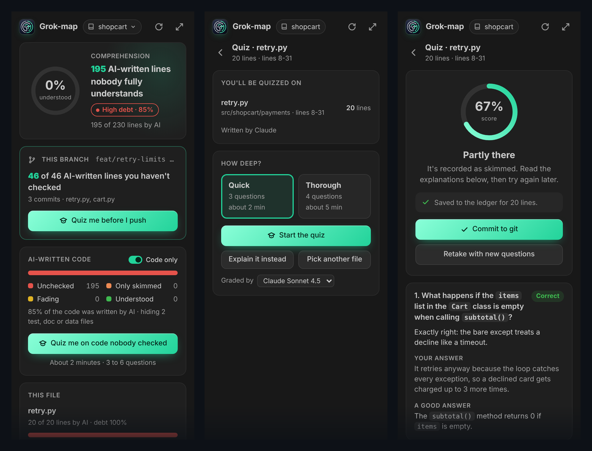

# Grok-map for VS Code

**See which AI-written code nobody on your team understands, and fix it with a 2-minute quiz.**



Grok-map traces every line to the commit that wrote it, recognises commits made by AI coding agents (Claude Code, Copilot, Cursor, Codex, Aider, Devin, Gemini…), and checks them against a ledger, kept in git, of who has *shown* they understand that code.

## The Grok-map panel

Click the **Grok-map** icon in the activity bar. Or open it as an editor tab with the ↗ button.

- **Pick any repository.** No need to open it as a folder first. Recent ones are one click away.
- **Install in one click.** No `grokmap` command yet? **Install for me** sets it up with uv or pip. New here? **Grok-map: Get started** walks you through it.
- **Check your branch before you push.** The panel shows the AI-written lines your branch adds that you haven't checked. **Quiz me before I push** covers exactly those lines.
- **Focus on real code.** **Code only** (on by default) leaves out tests, docs, data and generated files. Switch **Needs attention** between **Files** and **Folders** to see which areas of a big codebase nobody understands. Hover a row to quiz, **mark as reviewed** (counts as half understood), or **ignore** it for the whole team.
- **See where you stand.** Shows how much of the AI-written code anyone understands and which files need attention. Click a file to open it, or quiz yourself on it. It also shows who understands what, which agents wrote the code, and how much of each week's new code came from AI.
- **Get quizzed right there.** You see exactly which lines a quiz covers before it starts. Choose **Quick** (3 questions) or **Thorough** (4 to 6), or **Explain it instead** in a paragraph.
  - One question at a time, with **Finish now** if you've had enough.
  - Then a score with feedback and a good answer for each.
  - The result is saved to the ledger for exactly those lines, and the gutter updates.
  - **Commit to git** commits only the ledger, so your team sees it.
  - Questions are written and graded by the AI model you already have in VS Code, such as GitHub Copilot.
  - No API keys.
- **No model in VS Code?** One click hands the quiz to Claude Code, Copilot Chat, Kilo Code, Cline, Roo Code or Cursor's chat. Your assistant asks the questions and records the score through Grok-map's MCP server.

## In the gutter

| Gutter | Meaning |
|---|---|
| 🟥 red | AI-written, and nobody has checked it |
| 🟧 orange | Only skimmed: reviewed, or quizzed with a low score |
| 🟨 yellow | Understood, but more than 180 days ago |
| 🟩 green | Someone passed a quiz, explained it or paired on it |
| none | Written by a person, or not committed yet |

- **Hover** a coloured block to see which agent wrote it, in which commit, and who understands it. **Quiz me on this** opens the quiz in the panel.
- **The status bar** shows the file's comprehension debt. Click it to see who understands what.

The gutter follows your edits as you type. It also updates when anyone records a quiz, because the ledger is just a file in the repo.

## Install

Search **Grok-map** in the Extensions panel, or run `code --install-extension aadithya-kl.grokmap`.

## Requirements

The `grokmap` command-line tool, version 0.5 or later:

```bash
pip install grokmap        # or: pipx install grokmap
```

No install? The panel offers **Use uvx instead**, or set **grokmap.command** to `uvx grokmap`.

## Privacy

Grok-map reads your git history locally. It makes no network calls, and needs no account and no API keys.

The one exception is a quiz taken in the panel. It sends the lines being quizzed, and your answers, to the AI model you picked in VS Code, through VS Code's own language model API. VS Code asks your permission the first time. If you hand the quiz to an assistant instead, it goes wherever that assistant sends it.

## Settings

| Setting | Default | |
|---|---|---|
| `grokmap.enabled` | `true` | Show the gutter colours (also: **Grok-map: Toggle gutter colours**). |
| `grokmap.command` | `grokmap` | How to run Grok-map, e.g. `uvx grokmap` or a full path. |
| `grokmap.tintLines` | `false` | Also tint the background of AI-written lines. |
| `grokmap.statusBar` | `true` | Show the file's debt in the status bar. |

## More

Grok-map also has a CLI with an HTML heatmap, a GitHub Action that comments on pull requests, and an MCP server so your coding agent checks who understands a file before it edits it. See the [project README](https://github.com/Aadithya-kl/grokmap).
